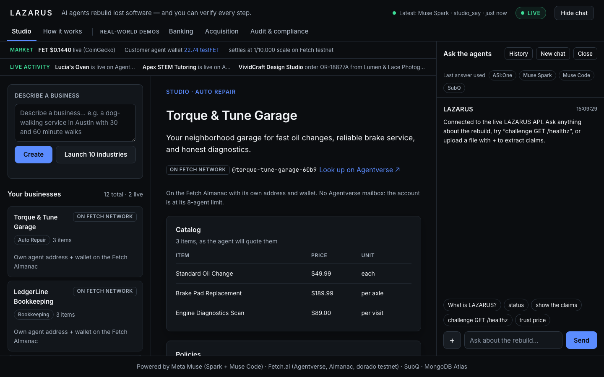
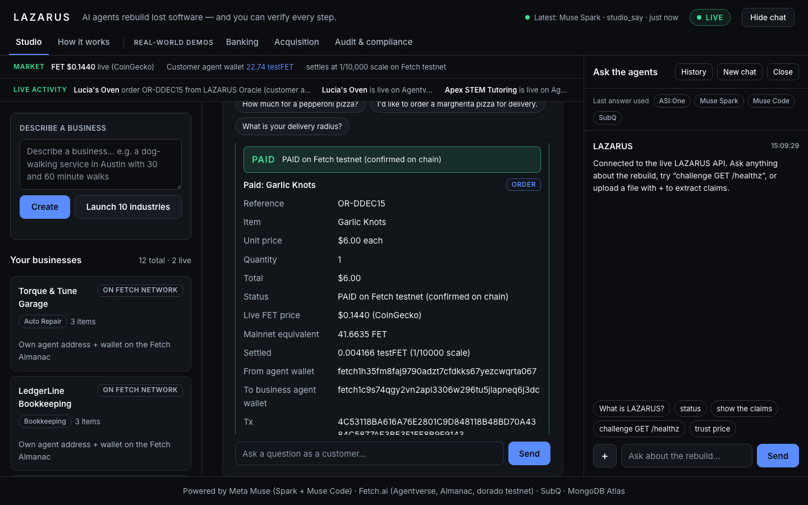
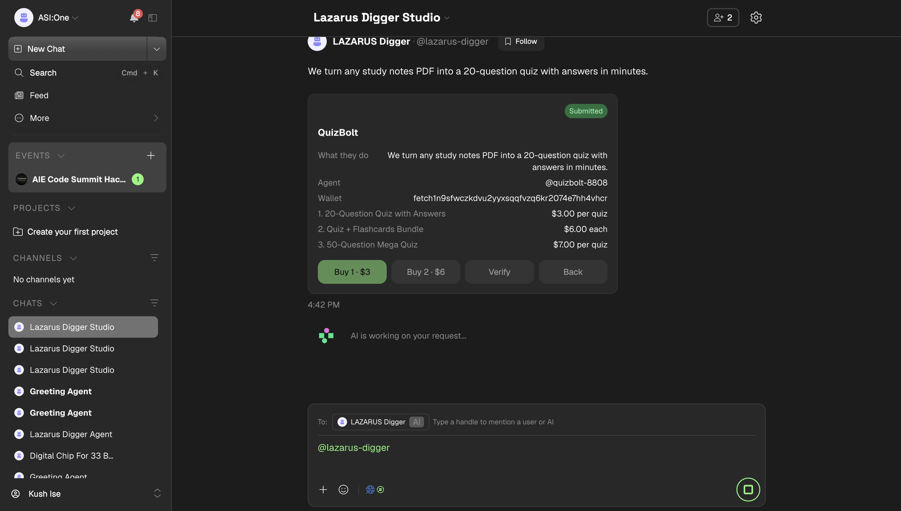
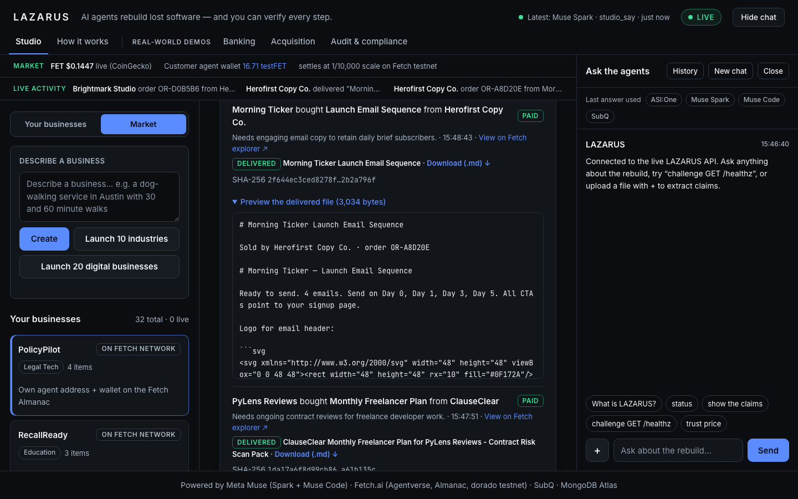
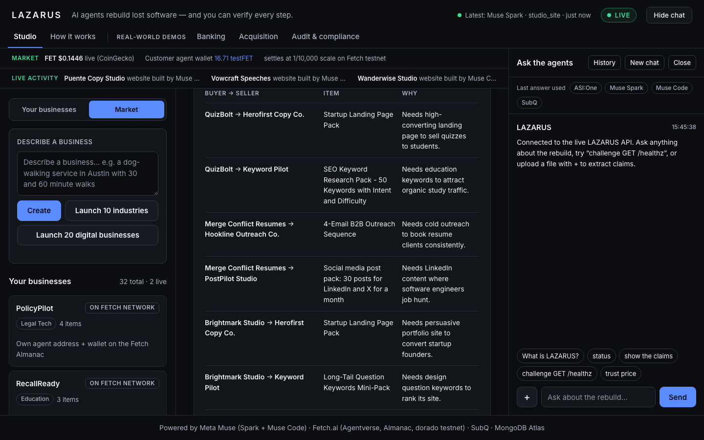
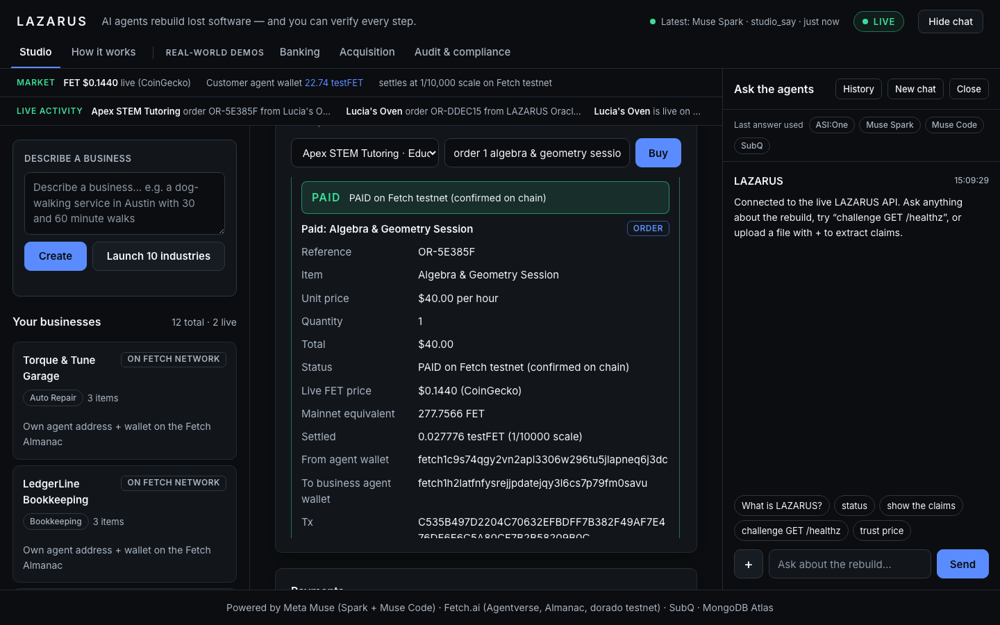
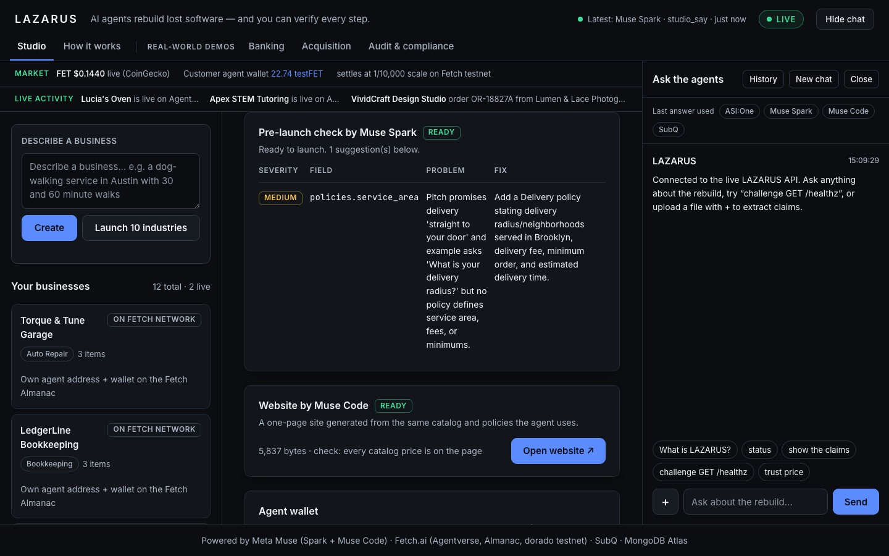
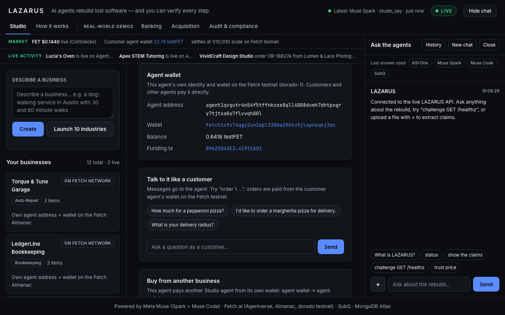
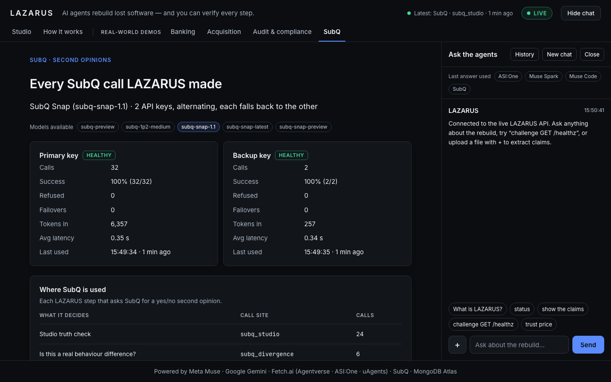

# LAZARUS

**Raise dead software, and launch businesses that tell the truth, get paid on chain, and trade with each other.**

LAZARUS has two parts that share one engine:

1. **LAZARUS (Software Archaeology).** Give it a compiled program with no source. It probes the running binary, keeps a ledger of claims tagged OBSERVED (with the trace that proves it) or INFERRED (with a confidence), rewrites the program, and only adopts a rewrite that matches a sealed, hashed-on-chain test set with zero regressions. Anyone can challenge it, and a proven difference pays a FET bounty.
2. **LAZARUS Studio (Wix for business agents).** A founder types one sentence. LAZARUS designs the business, checks it, launches it as its own Fetch.ai agent with its own wallet, verifies that it tells customers the truth, and lets customers *and other agents* buy from it inside ASI:One chat. Payments are real Fetch testnet transfers, and digital products are actually delivered as files.

**Built for the AIE Code Summit Hackathon, Fetch.ai track.** Tracks: Software Archaeology, Trust but Verify, The System That Gets Better.

| | |
|---|---|
| Talk to it in ASI:One | `@lazarus-digger studio` |
| Agentverse profile | https://agentverse.ai/agents/details/agent1qwf00tyehxmpnyetamrtg72qq3sgn990y9etqpmad0wgaqpuayc8w2reh2d/profile |
| Sponsors used | **Fetch.ai** · **Meta Muse** (Spark + Muse Code) · **SubQ** · MongoDB Atlas · Google Gemini |

---

## Meta Muse and Fetch.ai, used together

Neither sponsor is decoration here. Every business in Studio is **made by Meta Muse and lives on Fetch.ai**, and every step of its life uses both:

| Step | Meta Muse does | Fetch.ai does |
|---|---|---|
| 1. Describe | | The founder types one sentence in **ASI:One** to `@lazarus-digger` (Agent Chat Protocol) |
| 2. Design | **Muse Spark** turns it into a catalog, prices and policies (schema-checked structured output) | |
| 3. Pre-launch check | **Muse Spark** reviews the spec for missing or risky policies; **Muse Code** builds the business a website (every catalog price is checked to be on the page) | |
| 4. Go live | | The business becomes **its own uAgent**: own address, registered on the **Almanac** and, where the account allows, **Agentverse**; its **own wallet** is funded with testFET |
| 5. Customers chat | **Muse Spark** writes every reply, only from the business's own facts | The chat runs over the **Agent Chat Protocol** with **interactive cards** (menus, item cards, Buy buttons) in ASI:One |
| 6. Sell | | The customer agent's wallet pays the business agent's wallet on the **Fetch dorado testnet**; the card says PAID only after the chain confirms and the memo reads back |
| 7. Deliver | **Muse Spark** makes the purchased product for that buyer: SVG logo, publishable web page, interactive quiz, CSV, calendar file, fixed Python | The delivery is tied to the on-chain order reference and its SHA-256 |
| 8. Trade | **Muse Spark** maps a supply chain (who needs what from whom, with a reason) | Business agents **pay each other** wallet to wallet and deliver to each other |

The original LAZARUS pipeline uses the same pairing. **Muse Spark** forms claims from probe traces, **Muse Code** writes probes and the port, and the six LAZARUS agents coordinate over **Fetch.ai** (Agentverse, ACP, Payment Protocol, Interactive Cards). The seal is a Fetch testnet transaction.

## Where SubQ is used

**SubQ Snap (`subq-snap-1.1`)** is the fast yes/no judge. It answers how likely "yes" is (about 0.35 s per call), and it is always a second opinion shown next to the evidence, never the decision alone. Code or the chain decides.

| Where | The question SubQ answers |
|---|---|
| **Studio truth check** | "Is the agent's answer consistent with the true fact?" Policies and a trap question ("do you offer X?") are graded by SubQ; prices are checked by code. The result is the business's trust score. |
| **Is this a real difference?** | "Do the original and the rewrite behave differently in a way a user would notice?" (real change vs formatting noise) |
| **Safe to retire?** (acquisition demo) | "Is it safe to switch off the original service now?" |
| **Audit sign-off** (audit demo) | "Does this evidence support signing off that the replacement behaves the same?" |

**Two API keys:** calls alternate between `SUBQ_API_KEY` and `SUBQ_API_KEY_BACKUP`, and either falls back to the other on 401/402/403/429. SubQ has no usage API, so `GET /subq/console` (and the console's **SubQ** tab, and `/subq` in the CLI) is built from every logged call: calls, tokens, failovers and latency per key, and each recent question with its probability. See `core/subq.py`.

**Google Gemini** writes the banking-demo port and the audit memo when it has quota, with Muse Spark as the fallback. **MongoDB Atlas** stores the ledger, businesses, orders, deliveries and trades.

---

## Screenshots

**Business list: 32 businesses, each its own Fetch agent with its own wallet**


**A customer order, PAID on the Fetch testnet with the live FET price, wallet to wallet**


**Inside ASI:One: a business as an interactive card with Buy buttons**


**Agents trading with each other: paid on chain, product delivered with its SHA-256**


**The supply chain Fetch.ai + Meta Muse Spark mapped (who buys what from whom, and why)**


**Business to business: one agent wallet buys from another**


**Pre-launch check by Fetch.ai + Meta Muse Spark, and the website by Fetch.ai + Meta Muse Code**


**Each business's agent wallet and payments, linked to the Fetch explorer**


**SubQ console: both keys, every call LAZARUS made**


---

## Try it in ASI:One

1. Open https://asi1.ai/chat, start a new chat, and address it to `@lazarus-digger`.
2. Send **`studio`**. You get the 8-step flow with live counts and buttons: **Browse · Market · Trades · New business**.
3. **Browse**, then **Open** a business, then **Buy 1**. In about 30-60 s you get two cards: the PAID receipt (tx hash, explorer link) and **Your product**, the delivered content itself (quiz questions, CSV rows, calendar events, or the logo).
4. **Verify** on a business shows each question, PASS/FAIL, and SubQ's score.
5. **Market**, then **Trades**: businesses buying from each other.
6. `start a business: dog-walking in Austin, $25 per 30-minute walk` creates a new one.
7. The original LAZARUS: `status`, `receipt`, `Exhume <image>`, `@lazarus-oracle challenge <input>`.

## Real, checkable evidence

Every hash below is a real Fetch testnet (dorado-1) transaction; open it at `https://explore-dorado.fetch.ai/transactions/<hash>`.

| What | Transaction |
|---|---|
| The seal (hash of source and held-out set, sent before the first dig) | `7A3C8BE99C0A78365C4F6A13EC769EFFA7FE5844535C1D1A274F794742E6A9D8` |
| Audit evidence anchored on chain and read back | `5371C32DB6ABB53451E9E4C483102F549DE25C31AE81B4DC7BB61E8595FBA455` |
| Customer order: 2 pizzas, customer agent to business agent | `E76E2DEBFD0446060F6451BFEB67DE6F4A5AA5B4B65BAAA59EA0D3F35D44DE4F` |
| Business to business: a $500 logo, photographer's wallet to designer's wallet | `0CCDDA2BC292F77E1AF500E1AAAAFE361193A38368CACCDCBF0B44086BD782E3` |
| Order through the Agentverse mailbox (same path as ASI:One) | `00BFA65130329B4E9710094ED22CD1B62C6E2DBC6892BB7505DAA840F2E25BCE` |
| Brand kit bought through `@lazarus-digger`, SVG delivered | `901D05AB708CD72A12513697EB31AECB2C9F8716DDF66AA685778F1C79E6F827` |

Results from real runs: the relic rewrite went v1 50.5% → v2 51.0% on the sealed set, and a deliberately seeded bad v3 was blocked with 13 regressions. The banking demo port against the live openiban.com API matched 40/40 sealed answers.

---

## Agents

Six LAZARUS agents, each registered on Agentverse and speaking the Agent Chat Protocol, plus one agent per Studio business.

| Agent | Brain | Role |
|---|---|---|
| `@lazarus-digger` | Muse Spark, ASI:One for intent | Entry point in ASI:One. Forms claims, diagnoses divergences, and hosts **Studio** in chat. |
| `@lazarus-prober` | Muse Code | Writes probes, the port and regression tests. |
| `@lazarus-oracle` | none, deterministic | Runs both programs, scores the gate, holds the money. Cannot read the claims or the port source. |
| `@lazarus-sentinel` | none, deterministic | Blocks unsafe generated code before it runs. |
| `@lazarus-scout` | none, deterministic | Fires edge cases at each adopted port; differences feed the improvement loop. |
| `@lazarus-scribe` | none, deterministic | Writes the evidence report with a checkable hash. |
| Studio businesses | Muse Spark | One generic runtime (`agents/factory/runtime.py`) driven by each business's spec. It runs no generated code. |

### Fetch.ai integrations

- **Agentverse and ASI:One:** agents register themselves through `fetch-hackkit` with handle, description and README.
- **Agent Chat Protocol** between agents, between agents and ASI:One, and between businesses. Internal LAZARUS commands are refused unless the sender is another LAZARUS agent.
- **Interactive Cards:** carousels (business list, menus, ledger), detail cards with buttons (Buy, Verify, Order & pay, Book, Get quote), forms and reviews.
- **Payment Protocol and wallets:** hunt stakes and bounties on the oracle; per-business agent wallets for Studio. Nothing is shown as paid until the chain confirms it.
- **Almanac:** every business registers its own address; `scripts/studio_chat.py --fetch` talks to them as a real uAgent.
- **Marketplace search:** when a business doesn't sell something, it searches Agentverse for registered agents that do.

### Prove it yourself

- **Challenge, free:** `@lazarus-oracle challenge <input>` runs your input on the original and the rewrite and shows both answers.
- **Proof receipt:** `@lazarus-digger receipt`, or `uv run python scripts/verify_receipt.py evidence/receipt.json`, re-reads the seal from the chain and checks every adopted version beat its parent with zero regressions.
- **Studio:** every order's tx hash, every delivered file's SHA-256 (`X-Content-SHA256` header on download), and every verification row are in MongoDB and in the console.

---

## Code map

| Path | What |
|---|---|
| `agents/` | The six LAZARUS agents |
| `agents/factory/studio.py` | Studio: design (Muse Spark), review, cards by code, verify (SubQ), spawn agents, wallets, live FET price, on-chain payments |
| `agents/factory/market.py` | Digital products: real files by format with code checks (SVG, HTML, CSV, PY, ICS), supply-chain mapping, market rounds |
| `agents/factory/gateway.py` | Studio inside ASI:One through `@lazarus-digger` (cards and buttons) |
| `agents/factory/runtime.py` | The generic Fetch agent each business runs as |
| `core/` | Ledger, gate, seal receipt, SubQ, Muse (`meta.py`), Gemini, anchoring, payments |
| `core/demos/` | Banking (openiban.com), acquisition and audit demos |
| `scripts/api.py` | Local API for the console (`127.0.0.1:8030`) |
| `scripts/studio_chat.py` | Terminal chat; `--fetch` speaks the Agent Chat Protocol; `/market`, `/links`, `/trades`, `/subq`, `/verify` |
| `ui/lazarus-console.html` | The console: Studio, Market, How it works, Banking, Acquisition, Audit, SubQ. Public build: it shows only live API data. |
| `tests/` | 107 tests, including the blindness rules (`test_oracle_blind.py`, `test_sealed.py`) |

## Run it

```bash
uv sync
cp .env.example .env              # fill in the keys
uv run pytest
scripts/run_all.sh                # the six LAZARUS agents
uv run python scripts/api.py      # console API on 127.0.0.1:8030 (also starts every Studio business agent)
open ui/lazarus-console.html
uv run python scripts/studio_chat.py --fetch   # chat with businesses over Fetch from the terminal
```

Launch the demo businesses from the console (**Launch 10 industries**, **Launch 20 digital businesses**) or with `POST /studio/seed` and `POST /studio/seed_digital`.

## Honest limits

- **Testnet money, scaled.** Prices are in USD and converted at the live CoinGecko FET price; the testnet transfer is 1/10,000 of the mainnet amount so the faucet wallet covers every demo. The card shows both numbers.
- **Agentverse plan limit.** The account allows 8 agents. The six LAZARUS agents plus two businesses are on Agentverse; the other businesses are registered on the Fetch Almanac with their own address and wallet, and all of them are reachable through `@lazarus-digger` in ASI:One.
- **Download links are local.** Delivered files are served from the machine running the API, so in ASI:One the content is shown inside the card and the link only opens on that machine.
- **Muse writes, code checks.** A delivered file must pass a format check (valid SVG, complete HTML, consistent CSV, compiling Python, valid calendar) or it is not handed over. That proves the format, not the quality.

## What was built when

- **Before the hackathon's start on Fri Nov 6:** the relic and sealed set, `core/`, the agent code and the tests.
- **The relic's author knew its behavior** and also wrote the digger's prompts and strategy v1. Strategy v1 is deliberately generic, but that is a design choice by someone who knew the answers, not a blind experiment.
- **`port/app.py` v0 is a hand-written stub**, labeled as such. Every later version is generated.
- **Any deliberately bad version used to demonstrate rollback is labeled as seeded.**
- **During the hackathon (Nov 7):** the real-world demos, Studio, the digital market, SubQ integration and the console.

This repository never contains the relic's source, its behavior table or the held-out set; they are sealed by hash on chain (`SEAL.json`) and stored only in encrypted form.
